<p align="center">
  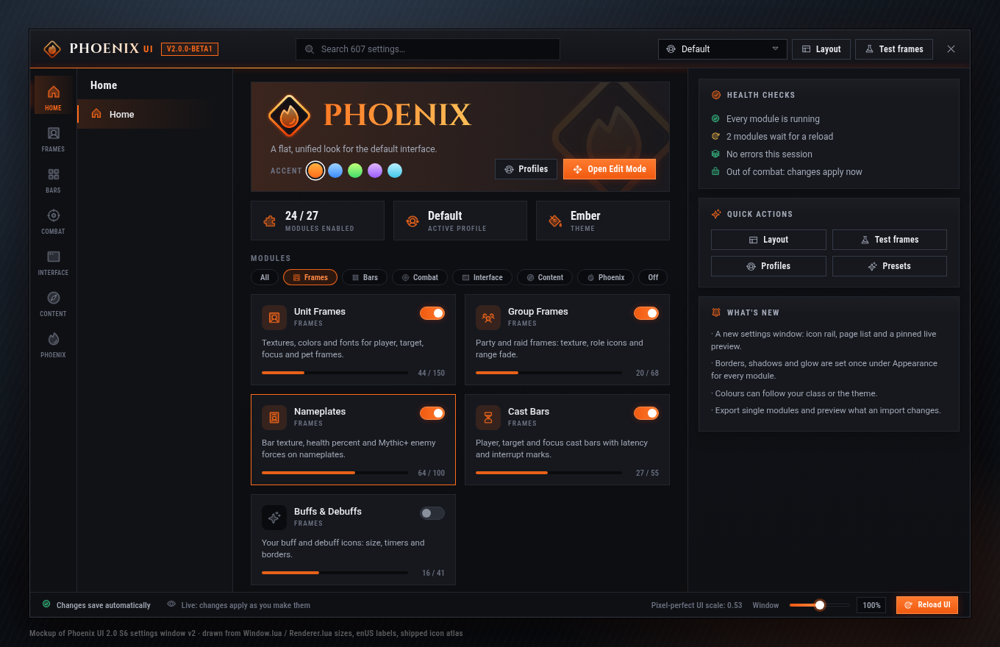
</p>

# Phoenix UI

**A flat, consistent look for the default World of Warcraft interface.**
Retail · Interface 120105 (12.1.5) · WoW Forever · Interface 16001 (1.60.1) · by **VortexQ8** · MIT licence

Phoenix UI builds on Blizzard's interface instead of replacing it. Edit Mode keeps control of layout, and Phoenix
adds a consistent look and small comforts on top. It restyles secure frames but never rebuilds them, which keeps
it light and out of the way of taint. It also catches Lua errors from every addon, and moves the few frames Edit
Mode cannot reach.

[CurseForge](https://www.curseforge.com/projects/1242528) ·
[Wago](https://addons.wago.io/addons/jK8XQjKy) ·
[GitHub](https://github.com/vortexq89/Phoenix_UI)

---

## Features

| Category | Module | What it does |
|---|---|---|
| System | **General** | Theme (Phoenix Ember, Frost, Fel, Arcane, Class, Custom), fonts, bar texture, font scale, reduce motion; 89 bundled fonts and 24 statusbars shared through LibSharedMedia |
| | **Bugs** | Catches Lua errors, blocked actions (taint) and Lua warnings from every addon; viewer with search, sessions and copy; data-bar count, minimap indicator, optional chat notice and sound; works alongside BugGrabber/BugSack |
| Interface | **Skins** | Phoenix styling (style-library background and border, title strip, close glyph, tabs) for 24 Blizzard windows and dialogs, each on or off: character, inspect, spellbook, group finder, collections, professions, auction house, mail, merchant, gossip, loot, achievements, journal, calendar, communities, friends, settings, Great Vault, keystone, trade, dressing room, game menu, popups, ready check |
| | **Action Bars** | Phoenix's own secure bars: bars 1–8, pet, stance and a quest/item bar with any number of buttons, lines, size, spacing, grow/wrap, backdrop and border; paging for forms, skyriding and modifiers with optional page arrows; show in/out of combat, fade, mouseover, custom macro; square, rounded, circle or hexagon buttons; range, power and unusable tints; proc and assisted-highlight glows; hotkey, macro and count text with short key names; extra/zone ability style, vehicle exit button, game-menu and bag buttons on mouseover. Bars move in Layout mode. Blizzard bars (Edit Mode) stay one switch away |
| | **Unit Frames** | Phoenix's own secure frames for player, target, target of target, focus, focus target, pet, boss 1–5 and (optional) arena 1–5: health, power, class resource (combo points, runes, stagger …) and encounter power bars; absorbs, heal absorbs and incoming heals; text tags (`[name]`, `[health:current-percent]` …) with per-text fonts; 2D, 3D or class portraits; raid marker, leader, role, PvP, combat, resting, elite, threat and ready-check icons; buffs and debuffs with dispel colours; range and out-of-combat fade; class, reaction, health-curve or theme colours; any border style; per-frame settings with apply to all, Test frames and Layout mode. Built for 12.x secret values. Blizzard's frames (reskinned) stay one switch away |
| | **Group Frames** | Phoenix's own party, raid, main tank/assist and pet frames on secure group headers: party, 10-20 and 25-40 layouts with size, growth, spacing and sorting (group, role, class, name); health with absorbs and heals, range fade, power by role, tags, role/leader/ready/summon/res/phase icons, aggro border, dispel highlight, buff/debuff rows with secret-safe filters, big defensive, private auras; click-cast addon support, Test group (5/20/40) and Layout mode. Blizzard's frames (restyled) stay one switch away |
| | **Cast Bars** | Phoenix's own cast bars for player, target, focus, pet, boss and arena, on the unit frames or free: interruptible/locked/channel colours, kick-ready tick, spark, latency, channel ticks, empower stages, spell target, GCD bar (retail) and swing timer (Forever); icon, name and time options, Test casts and Layout mode. Secret-safe for 12.x; Blizzard's bars (reskinned) stay one switch away |
| | **Buffs & Debuffs** | Your buffs, debuffs and weapon enchants on Phoenix aura containers: size, square or wide icons, rows, grow, sort, own first, type borders, swipe, timer formats and colours by time left, right-click cancel in combat, private aura anchors, Test auras and Layout mode. Blizzard's frames (reskinned) stay one switch away |
| | **Nameplates** | Phoenix's own nameplates with separate enemy and friendly styles: health bar with absorbs, reaction/class/health colours, threat colours by role (with off-tank), quest-mob colour, execute range; target glow, border or arrows, focus and mouseover highlights, class resource on the target; cast bars from the Cast Bars engine with an important-cast colour; name, health, level and guild tags; debuff and enemy buff rows with secret-safe filters; raid marker, quest, elite and rare badges; Mythic+ forces; per-zone styles (open world, dungeons/raids, PvP); stacking, overlap, distance and visibility CVars; click area; Test plates and a live preview. Blizzard's plates (restyled) stay one switch away |
| | **Tooltip** | Dark style, class and quality borders, class- and reaction-coloured names, health bar with percent, anchor at the cursor (right, left, above) or a Layout-mode mover, scale, hide in combat with a chosen modifier key (units or every tooltip); guild rank, realm, target, targeted by, role, item level and specialization (inspect), mount (owned or not), Mythic+ rating, item counts (bags, bank, warband) and IDs of eight kinds (spell, item, NPC, aura, currency, quest, achievement, mount); secret-safe |
| | **Item Level** | Item levels on the character sheet and bags |
| | **Bags** | Optional Phoenix bag window (one combined grid or category sections you reorder and hide, sorted by quality, item level or name) with columns, slot size, spacing, scale, search, sort (with direction), gold and currency footer, free slots; slot borders, quality, junk coin, new-item glow, bind-on-equip/warbound label, cooldowns, count font, upgrade arrows and item levels; Blizzard bank and warband bank styled; opens with the auction house and trade |
| | **Sim** | SimulationCraft from the game: tick bag gear on a paperdoll, compare it, find the best set or get stat weights; the Phoenix app runs the sim on your PC and the result shows as DPS per set, a tooltip line and the bag upgrade arrows |
| | **Minimap** | Round, square or rectangular minimap with a border from the style library; zone text (PvP colours), clock and coordinates in your fonts; show or hide Blizzard's calendar, tracking, mail, crafting order, difficulty, expansion, compartment and zoom buttons; mouse wheel and auto zoom-out; a LibDBIcon button bin (columns, size, keep-list, show on hover); who-pinged names and world map coordinates; size stays in Edit Mode |
| | **Data Bar** | Two panels of data texts you drag between and reorder: FPS, latency, speed, durability (warn level), gold (account-wide with the warband bank), local/realm clock, bug count, bag slots, item level, friends, guild, mail, specialization and loot spec, Mythic+ key, coordinates and volume; tooltips (hidden in combat if you like), width, alignment, mouseover; an experience/reputation bar with rested overlay and text; movable in Edit Mode |
| | **Movers** | Move, scale and fade frames Edit Mode does not manage: zone text, error messages, alerts, top-center widgets, boss banner, event toasts, ready check |
| Combat | **Cooldown Manager** | Blizzard's Cooldown Manager in Phoenix style and layout: icon grids with rows, sizes, spacing, growth, overflow and keep-in-place, proc and ready glows, grey-out on cooldown, keybinds, visibility and per-spec rules, three custom bars for other spells, items and trinkets, and pre-pull reminders (flask, food, rune, oil, raid buff, pet, healthstone, mana on ready check) |
| | **Cooldown Text** | Blizzard's countdown numbers in your font, scaled to the icon, with tenths, a minimum duration, hiding on aura icons and optional colour by time left on action buttons |
| | **Encounters** | Boss timers as Phoenix bars and boss warnings in a Phoenix banner (from the game's own encounter timeline), every Blizzard boss-warning setting, a Test button, pull and break timers shared with DBM/BigWigs users, the countdown voice, and a Phoenix bar style for BigWigs/LittleWigs |
| | **Combat Text** | Every floating combat text option in one page |
| | **Damage Meter** | Skin for Blizzard's built-in meter; optional one-click Details! style |
| | **Spell History** | A strip of your recent casts, movable in Edit Mode |
| | **PvP** | Safe queue pop with timer, TAB targets players in PvP, `/gg` to surrender an arena |
| Social | **Chat** | Styled windows (background, border), fading, lines kept, hide in combat, side buttons, jump-to-bottom; tabs that glow in the accent colour, whisper-coloured, fading and a selected-tab colour; the game's timestamps, class-coloured names and whisper mode in one place; short channel names, item levels and icons on links, role icons, keyword highlight with a sound, spam filter; edit box above the window and styled, history length; a chat bar (channels, roll, ready check, pull) and a raid-marker picker; clickable URLs, copy chat and Shift/Ctrl wheel scrolling. Restricted chat (encounters, M+, PvP) is passed through untouched |
| | **AFK Screen** | A calm full-screen view of your character while away |
| Utility | **Quality of Life** | Hide talking heads, quiet errors in combat, achievement screenshots, Cooldown Manager toggle |
| | **Automation** | Repair, sell junk, fill "DELETE", decline duels, accept friend invites and resurrections, release in BGs, skip seen cinematics |
| | **Quests** | Restyled objective tracker (fonts, colours by difficulty, level tags, bar texture, width, height, collapse in instances, fade in combat); a waypoint arrow with distance and ETA; Phoenix pins on the world map and minimap for quests you can take now, quest lines and turn-ins, filtered by expansion, from the load-on-demand **Phoenix_UI_Data** addon (AllTheThings facts, MIT); quest tooltips; auto accept/turn-in with Shift to pause and a reward picker (vendor value or Sim) |
| | **Group Finder** | Filter panel beside the premade group list: presets, difficulty and role filters, leader score and best key, age, item level, PvP rating, friends, voice, bosses defeated, Bloodlust / battle res, a Phoenix filter expression with a live count; non-matching groups dimmed, matches outlined and listed by fit, score or age; leader score, best key and class colours on entries and applicants; click-again and Enter sign-up, a role-check accept key (retail) |
| | **Mythic+** | Run timer with chest thresholds, enemy forces, boss splits, deaths and personal bests; ahead/behind against your best run, the current pull on the forces line (when the game allows it); party keystones over LibKeystone (works with BigWigs and DBM users); auto-insert your keystone, report your new key |

Every module can be switched off. Modules that hook Blizzard frames ask for a reload when you turn them off.

Home shows **this week** at a glance: Great Vault progress for dungeons, raid and world, your Mythic+ rating, runs
and best key.

**Languages:** English, Deutsch, Français, Español (ES and MX), Português (BR), Русский, Italiano, 한국어, 简体中文 and
繁體中文, every string. Korean and Chinese clients draw all Phoenix text with the game's own font so no glyph is ever
missing; Russian clients only offer bundled fonts that include Cyrillic.

## Screenshots

| | |
|---|---|
|  |  |
|  |  |
|  |  |
|  |  |
|  |  |
|  |  |
|  |  |
|  |  |
|  |  |
|  |  |
|  |  |
| 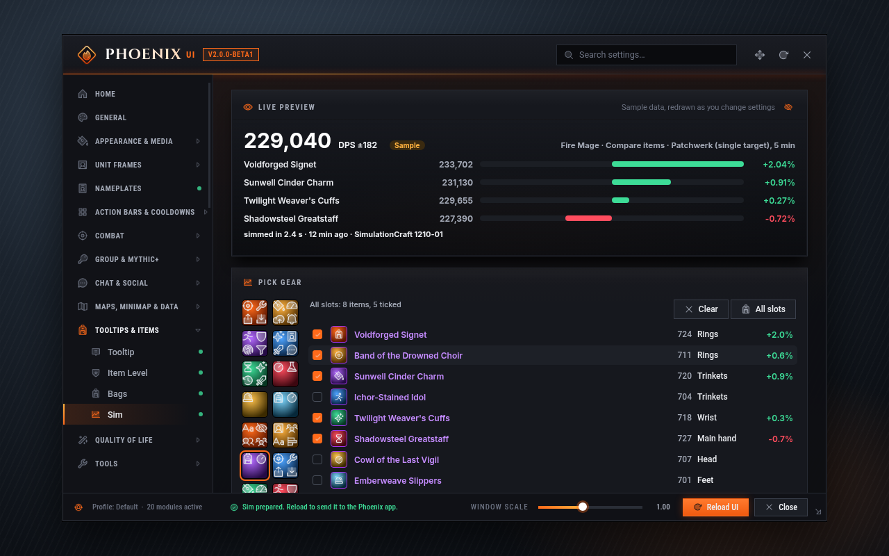 | 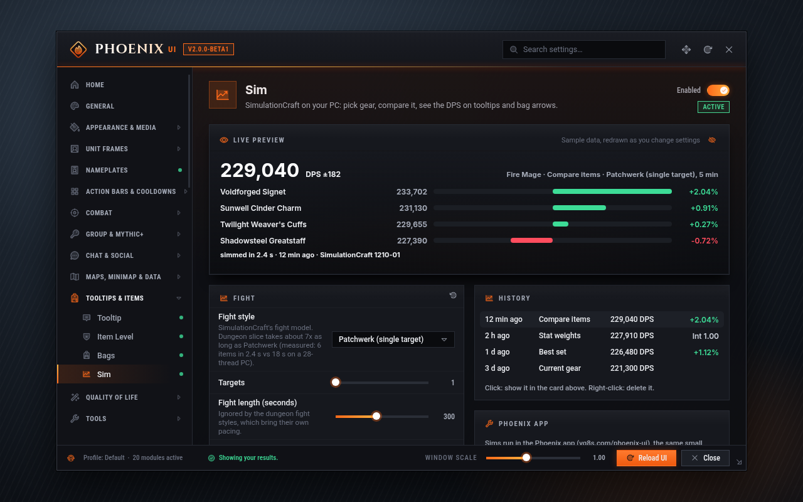 |
| 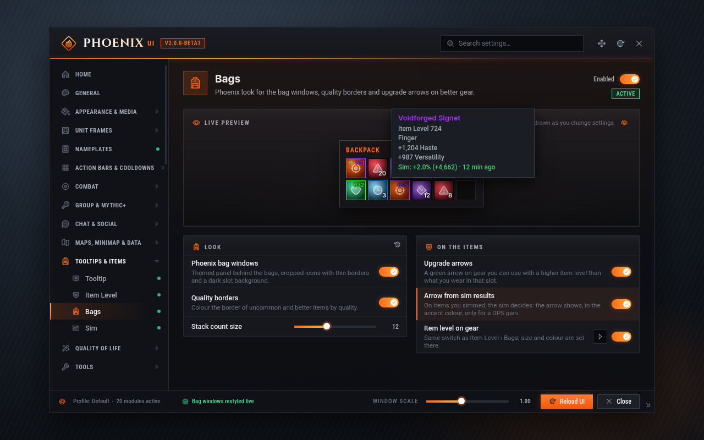 | 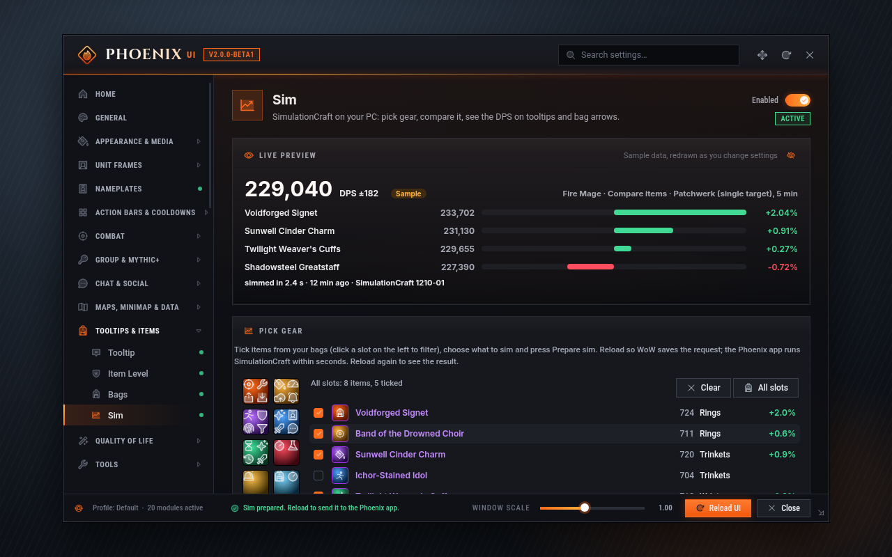 |

### Settings window

Seven groups on the icon rail, the open group's pages beside it, the page, and a live preview pinned on the right.
Compact rows pair up, a card's switch sits in its header, element chips edit one frame, several or all, and one
style library (Pixel, Thick, Inset, Glow, Ember borders; Soft, Hard, Glow shadows; Solid, Gradient, Glass
backdrops) drives every module. Search knows `hp`, `cd` and friends; profiles export single modules and preview
what an import changes.

| | |
|---|---|
| 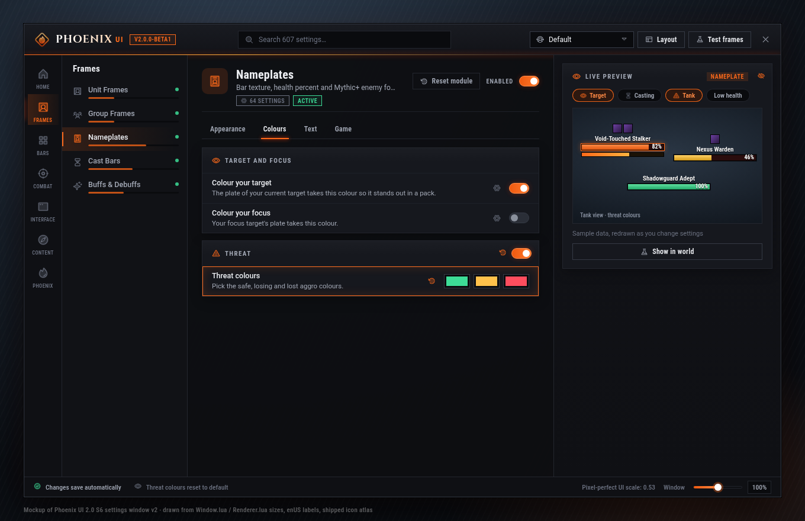 | 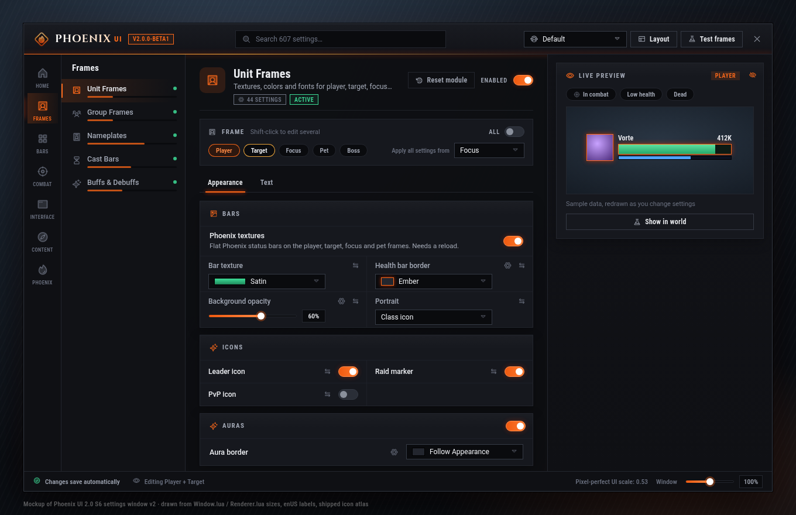 |
| 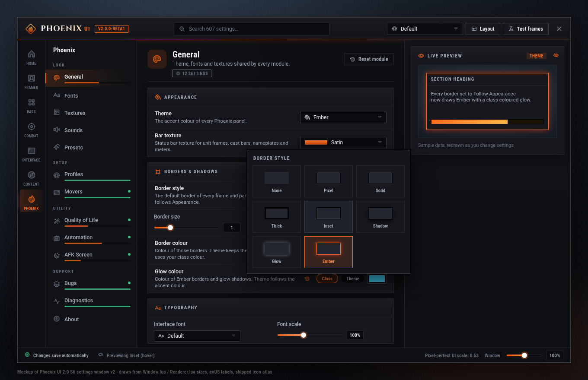 | 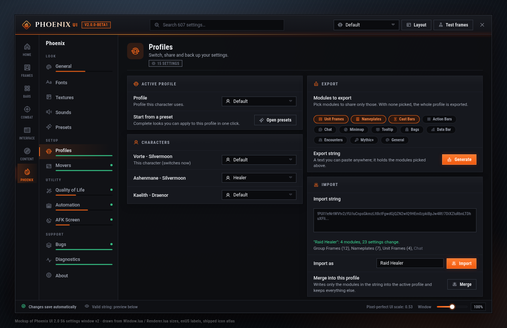 |
| 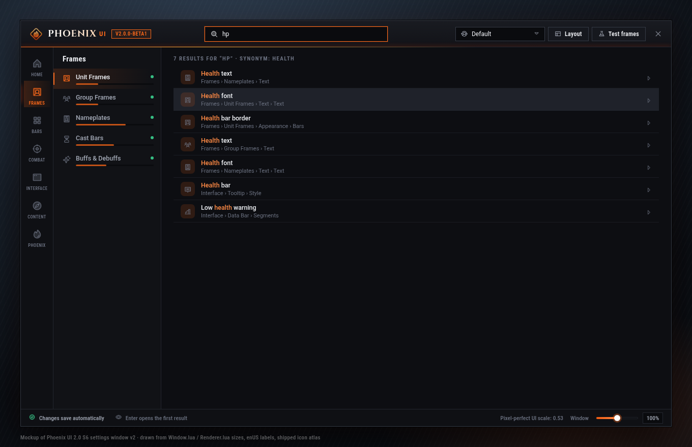 | 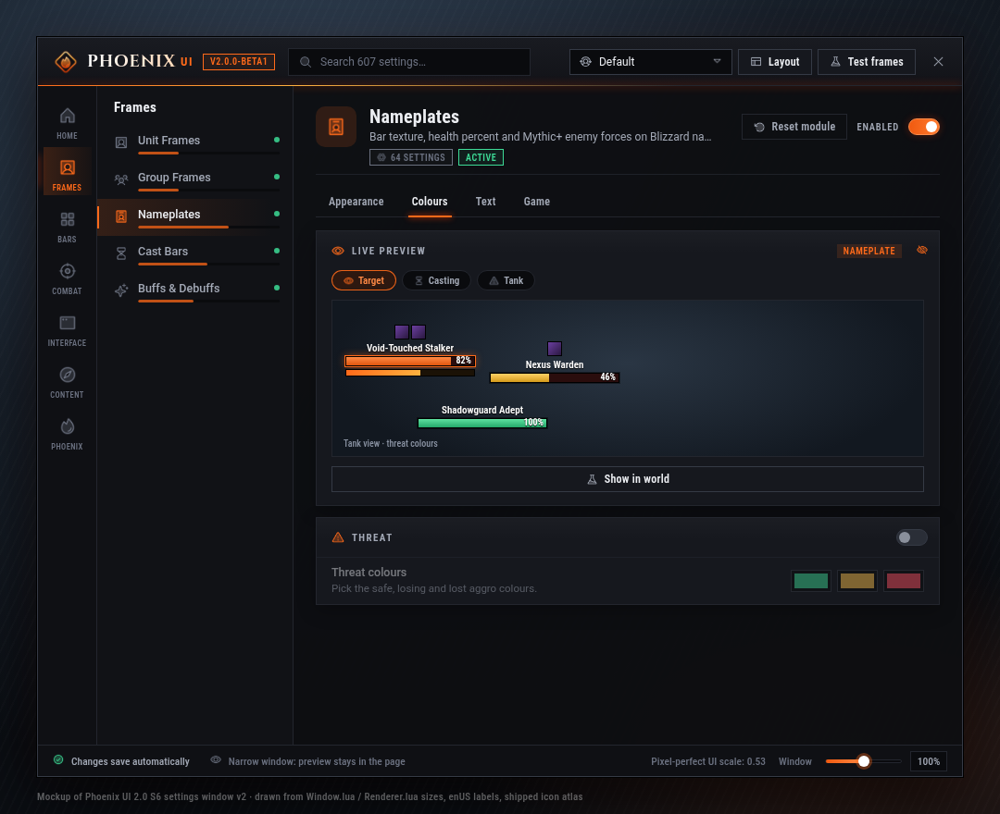 |

The screenshots are design mockups of the settings window rendered from HTML (`docs/screenshots/src`, the window v2
screens by `s6.py`) with the
same rasterized icon atlas the addon ships. The Mythic+ page shows the in-world timer at 150 % and sample nameplates.

### Icons

Every icon in the window, the data bar and Phoenix's own frames comes from one set: 109
[Phosphor](https://phosphoricons.com) duotone glyphs (MIT), packed into white atlases with 24, 48 and 64 px
cells and tinted by the active theme. Each icon picks the atlas that matches its size in physical pixels,
so it stays sharp from 1080p up to 4K at a UI scale of about 1.15.


## Installation

Install from CurseForge or Wago, or download a release and extract **both** folders, `Phoenix_UI` and
`Phoenix_UI_Options`, into `World of Warcraft/_retail_/Interface/AddOns/` (WoW Forever: the same two folders into
the Forever client's `Interface/AddOns`; Battle.net → *World of Warcraft: Forever* → cog → *Show in Explorer*). `Phoenix_UI_Options` is the settings
window; it is load-on-demand, so it costs no memory until you type `/pui`. Keep both enabled in the AddOns list.

## Usage

| Command | Action |
|---|---|
| `/pui` or `/phoenix` | Open or close the settings window |
| `/pui edit` | Open Edit Mode |
| `/pui bugs` | Open the bug viewer (`/pui bugs clear`, `/pui bugs options`) |
| `/pui movers` | Unlock or lock the movers |
| `/pui profile [name]` | Show or switch the profile |
| `/pui reset` | Reset the settings window position |
| `/pui <module>` | Jump to a module, e.g. `/pui tooltip` |
| `/pui settings` | Open the Phoenix page in Blizzard's settings |
| `/pui help` | List every command in chat |
| `/pui diag` | Check that textures, icons and fonts load (Phoenix → Diagnostics shows the result) |
| `/pui bugs share on\|off` | Allow or stop error reports to the author |
| `/pui debug` | Toggle debug output |
| `/gg` | Surrender an arena match (PvP module, asks first) |

You can also open the settings from the Addon Compartment (the button by the minimap) or from
*Options → AddOns → Phoenix UI*.

### Bug reports

The Bugs module records every Lua error, blocked action and Lua warning, from load time on, without taking over
Blizzard's error window or BugSack (it hands every error on to them). Repeats are counted instead of stored twice.
Open the viewer from the data bar, the minimap bug button, a right-click on the Addon Compartment entry or
`/pui bugs`, and use **Copy** to paste a report anywhere.

Reports are saved to `WTF\Account\<account>\SavedVariables\Phoenix_UI.lua` when you log out or reload. To share
them with the author, run the **Phoenix Uploader** app for Windows from
[vq8s.com/phoenix-ui](https://vq8s.com/phoenix-ui): it sends new reports to VQ8S.com. Nothing leaves your PC
otherwise. **Send error reports to the author** (Bugs page, on by default) decides whether the uploader may send
this account's reports; turn it off there or with `/pui bugs share off`. What is sent: the error text, call stack,
locals, addon and game version and client language. Character names, realms, GUIDs, BattleTags, chat text and
account or Windows user names are removed first. The file format is documented in
[docs/BUG_REPORTS.md](docs/BUG_REPORTS.md).

### Sim

The Sim page (Tooltips & Items, or `/pui sim`) runs [SimulationCraft](https://www.simulationcraft.org) for your
character through the **Phoenix Uploader** app (1.2.0 or newer, Windows). Addons cannot start programs, so a sim
takes two reloads: tick the bag items to try, choose the mode and fight, press **Prepare sim** and **Reload to
send**; the app picks the request up from your saved variables within seconds and runs the sim; after the next
reload the result is on the page, on item tooltips and on the bag arrows. Results stay for 14 days (adjustable) and
the last 10 per character are kept.

SimulationCraft is not part of Phoenix and is not bundled. The first time, the app asks before it downloads the
SimulationCraft build pinned in this repository (about 115 MB, from the SimulationCraft team's server) and refuses
it unless its size and SHA-256 match the pin, which is taken from SimulationCraft's official GitHub build. Nothing
about you is uploaded; sims run on your PC. Details and every option: [uploader/README.md](uploader/README.md).

### Movers

Edit Mode places the minimap and most of the HUD. Phoenix action bars, unit frames, cast bars and aura blocks (the defaults) move in **Layout** mode instead: the button in the settings top bar, on the Action Bars page or on the Unit Frames page. `/pui movers` unlocks the frames it does
not cover: drag to move, mouse wheel to scale (Shift: opacity), arrow keys to nudge, right-click to reset, with an
optional snap grid. Positions are saved per profile. Movers never touches an Edit Mode frame and locks itself in
combat.

### Profiles

Profiles are shared across your account. You can create, duplicate, rename, reset and delete them, switch
automatically per specialization, and share them as text strings. An import shows what the string contains before
anything is changed.

### WoW Forever

The same release runs on WoW Forever (interface 16001): the client picks `Phoenix_UI_Forever.toc`. Pages for things
Forever does not have are left out instead of shown broken: Mythic+, Sim, the Great Vault card, Mythic+ rating and
enemy forces, and the boss timeline and warnings on the Encounters page (pull and break timers, their bars and the
countdown voice stay). Profiles move between the games as they are. The Phoenix app does not watch the Forever
client yet, so copy errors from `/pui bugs` by hand there.

### Upgrading from Phoenix UI 11.x

On first login, 2.0 imports your old profiles once where the setting still exists (theme, automation, tooltip,
action bar text, cast bar extras, chat links, PvP options and more). Everything else starts from fresh defaults.

## What changed in 2.0, and where features went

12.x changed what addons are allowed to do. Addons can no longer read the combat log, and many combat values are
"secret" in restricted content. Blizzard also now ships many features that used to need addons. Phoenix UI 2.0
follows that. It skins and configures the Blizzard features and no longer bundles copies of other addons.

| Old Phoenix feature | Use instead |
|---|---|
| Frame mover (MoveAny) | Blizzard **Edit Mode** (`/pui edit`) + Phoenix **Movers** (`/pui movers`) |
| Scrolling combat text (MikScrollingBattleText) | Phoenix **Combat Text** page (Blizzard floating combat text), or [MikScrollingBattleText](https://www.curseforge.com/wow/addons/mikscrollingbattletext) (the 12.x rewrite) |
| Group finder filters (Premade Groups Filter) | [Premade Groups Filter](https://www.curseforge.com/wow/addons/premade-groups-filter) |
| Buff overlays on raid frames (BuffOverlay) | Blizzard raid frame aura settings. BuffOverlay does not work in 12.x, where aura data is secret in restricted content |
| Cooldown tracker / spell notifications | Phoenix **Cooldown Manager** page on top of Blizzard's Cooldown Manager for your own cooldowns, plus custom bars. Party cooldown tracking relied on the combat log and was dropped |
| Details! skin | Phoenix **Damage Meter** page (Blizzard meter skin + one-click Details! style) |

## Development

```bash
luacheck .                          # zero warnings, generated 12.1.5 API std
python3 tools/check_api.py          # APIs, events, CVars, templates, atlases vs. 12.1.5; load-chain check
python3 tools/check_ids.py          # every icon path, atlas, spellID, SOUNDKIT and enum fallback vs the pinned 12.1.5 snapshot
python3 tools/check_locales.py      # locale coverage; every translation complete
lua5.1 tools/smoke/harness.lua .    # offline load test
python3 tools/check_flavors.py      # all of the above for retail and again for WoW Forever 1.60.1
```

CI runs them on every push, for both games. The in-game checklist for a release is [`docs/TESTING.md`](docs/TESTING.md).
 Read [`AGENTS.md`](AGENTS.md) and [`docs/ARCHITECTURE.md`](docs/ARCHITECTURE.md)
before contributing. They cover the module contract, taint and secret-value rules, and the theme tokens.

## Credits

- Libraries: LibStub, CallbackHandler-1.0, LibSharedMedia-3.0, LibEditMode (each under its own licence).
- Fonts: 89 faces in 36 families (Inter, Barlow, Oswald, Fira Sans, Rajdhani, Cinzel, Roboto and more) under the
  SIL Open Font License 1.1, the Ubuntu Font Licence or Apache 2.0. See `Media/Fonts/FONTS.md` and
  `Media/Fonts/Licenses`.
- Icons: [Phosphor Icons](https://phosphoricons.com) 2.1.1 (© 2023 Phosphor Icons), MIT License
  (`Media/Icons/LICENSE`). Rasterized by `tools/media/gen_icons.py`.

## Licence

MIT © 2024–2026 VortexQ8. See [LICENSE](LICENSE).
